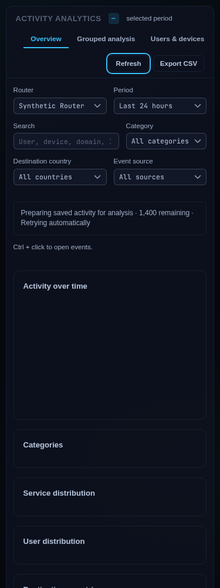
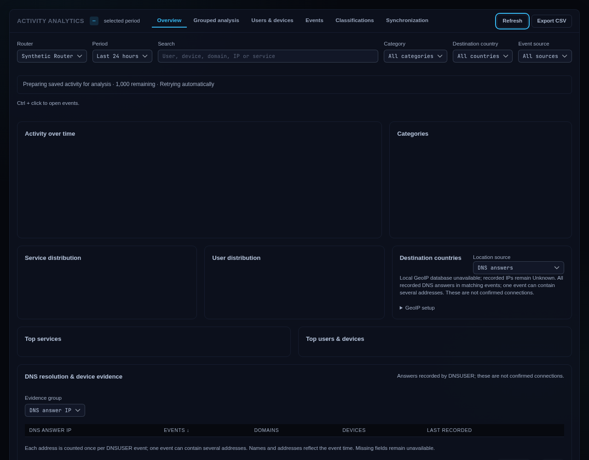
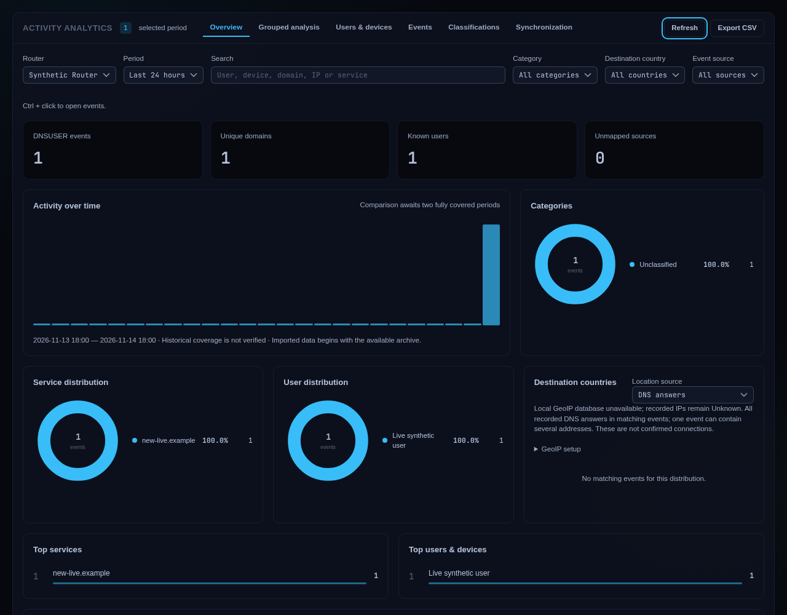
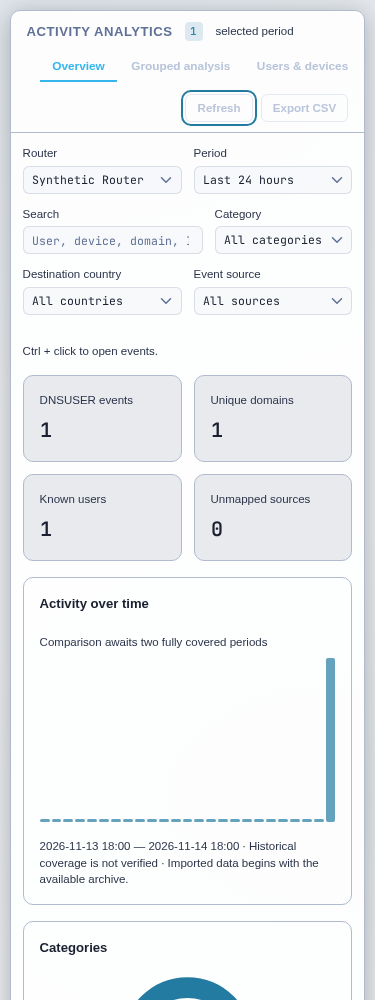

# Activity container query preparation — Issue #103

## Observed failure and diagnosis

On 2026-11-14 the owner reported `Activity query failed` in Activity Overview.
The authorized target was inspected directly using the existing encrypted router
credential. It is ARM/v7, RouterOS 7.24.5, running MikroDash 1.0.3. No router
configuration, resource limits, authentication, application entrypoint or existing
data was changed. The production service was not restarted or replaced.

Read-only SQLite diagnosis on that target found schema 45, 205,376 source
observations, zero pending source-index rows, 32,564 derived shapes and only
18,391 ready shapes. Thus source indexing was complete while 14,173 analytical
shapes were unprepared. The database occupied about 546 MiB; disk space was
available. Memory-high was 128 MiB and memory-max 192 MiB; the cgroup was near its
soft boundary, with 3,051 recorded high events and zero OOM kills. These are
point-in-time measurements, not a controlled performance benchmark. MikroTik
[documents memory-high as a soft pressure boundary](https://manual.mikrotik.com/docs/containers/#properties).

A private isolated snapshot reproduced the old query's 20-second deadline during
preparation. The old handler returned the generic 500 and the page did not
schedule another attempt after failure. Production HTTP failure details were not
logged by that build; the target database state and isolated deadline reproduction
identify this preparation failure path, without claiming other storage errors
cannot produce the same generic message. Existing private router credentials
were used successfully; no application password was guessed or reset.

## Resulting behavior

- Each request gives local preparation a two-second budget and commits enrichment
  in 100-shape batches. Slow hosts retain progress between requests.
- Context invalidation also commits bounded batches. An opaque JSON cursor in the
  existing projection-context version records progress until the final digest
  commits. No schema change or source-event rewrite is required. There is one
  durable authority instead of a second in-memory context cache.
- Pending requests return HTTP 202, Retry-After, preparing/preparationPending and
  refreshAt. Counts include all stale shapes while context invalidation is still
  in progress. No partial result is aggregated or cached.
- Activity shows visible preparation and retries through its existing visibility,
  cancellation and request-generation guards. Old coverage, counts and pagination
  are cleared. Optional dashboard cards also distinguish preparation from zeros.
- Complete results retain HTTP 200. Status/rules remain available during
  preparation. Authorization is rechecked on each response/retry. Actual caller
  cancellation and permanent storage failures remain errors; internal failures
  now leave sanitized operator diagnostics.

The budget bounds resumable work rather than guaranteeing a two-second wall time:
SQLite's existing five-second busy timeout, scheduling and synchronous local
lookup work can add delay. This change does not extend the 20-second analytical
query deadline or guarantee every high-cardinality query will meet it.

## Verification evidence

- Real HTTP/SQLite regression: a competing writer produces explicit 202 with JSON,
  no-store and retry headers; releasing it permits a complete result; revoking
  authority refuses the next request.
- Slow synthetic enrichment: pending responses retain progress, contain no
  analytical rows/charts, are not cached, and eventually return all 600 DNS
  observations and 600 answer groups. Source revision/count remain unchanged.
- Real SQLite fault after the first invalidation batch: the committed cursor and
  100 invalidated shapes survive a reopen; retry finishes without losing sources.
- A negative control restoring the unbounded preparation path fails the new
  regression. Original failure output is retained locally.
- The selected synthetic preparation regression was cross-compiled for ARM/v7 and
  passed **on the actual target** in 32.81 seconds, including seeding and all
  retries, with one Go CPU and a 12 MiB Go memory target. It used an isolated
  temporary schema-47 fixture, not the production schema-45 database. This is
  hardware regression evidence, not production endpoint latency or deployment.
- All temporary diagnostic executables, chunks and receipts were removed by their
  exact owned Linux paths and absence checked. An initial RouterOS file-list
  normalization mistake was corrected; an empty listing is not cleanup proof.
- Full Activity browser journey passed in 202.50 seconds, including existing
  clipboard, chart selection, live arrivals/anchors, permissions and keyboard
  regressions. The final focused preparation journey passed in 19.43 seconds:
  375/768/1280/1920, dark/light, eight zero-violation axe checks, visible progress,
  automatic complete retry, preserved URL/focus and cleared stale result controls.
- The related Go packages passed (db, activity, activitywire and server), and all
  six optional-card unit cases passed. Final full repository/CI evidence is
  recorded on #103 after the source is committed.

Retained correction history: the first ARM run exposed zero progress from a bulk
context invalidation rollback; invalidation is now durable too. The first browser
run caught preparation text being written into the hidden Synchronization panel;
the final page-shell status is visible and its disappearance is asserted. The
focused empty-state accessibility check also caught missing chart group semantics;
the labelled interactive containers now retain valid roles while empty.

## Synthetic visual evidence






Hashes and the source fingerprint are in [the capture manifest](verification/activity-103/manifest.json).

Final four-width dark/light preparation captures and complete-result images are
produced by `web/test/browser/activity-preparing-journey.cjs`. The existing full
Activity journey invokes the same preparation regression and continues its chart,
copy, live-update, authorization and accessibility acceptance.

Run the focused journey with:

```sh
MIKRODASH_ACTIVITY_BROWSER="$PWD/web/test/browser/activity-preparing-journey.cjs" \
  go test ./internal/server -run '^TestActivityBrowserJourney$' -count=1 -v -timeout 4m
```

Run the existing full journey with MIKRODASH_ACTIVITY_BROWSER=1. Source snapshots,
credentials, router logs and diagnostic receipts remain private/ignored; no
operator data is included in these images or fixtures.

This development delivery does not publish a Docker image or deploy to the target.
The installed 1.0.3 service remains the operational baseline until a separately
authorized release/deployment.
