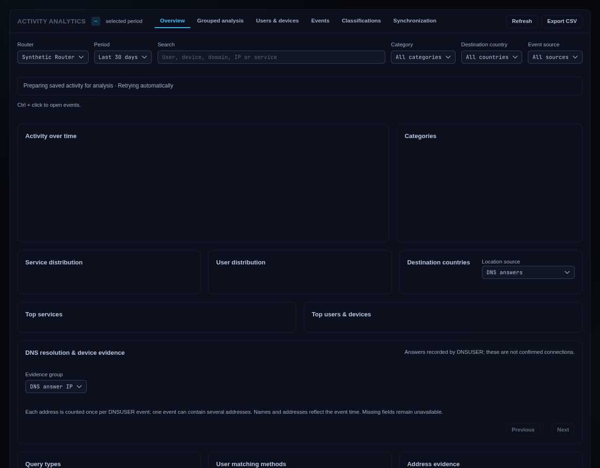
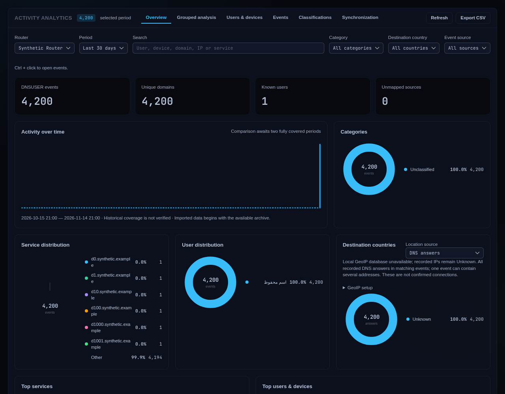
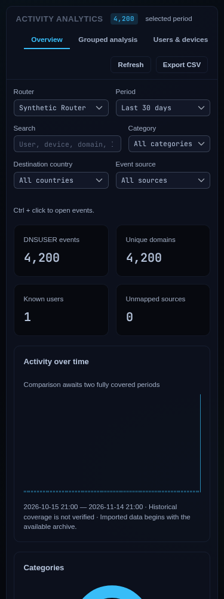

# Activity query structure and range verification — Issue #109

Release: 1.0.5, schema 48. Publication and deployment acceptance are recorded
separately on Issue #111; this document does not claim a deployment merely from
a source change or image publication. The existing v1.0.4 image/tag remains
immutable. The checks below distinguish synthetic HTTP and read-only hardware
evidence from actual production UI acceptance.

## Storage and observed bottlenecks

MikroDash uses SQLite (`/data/mikrodash.db` in the container), rather than a
separate database server. Subscriber accounting/RBAC and Activity share the file
but have separate tables and ownership. Activity's authoritative source remains
`activity_events`; derived tables may accelerate reads without replacing it.

| Layer | Tables | Purpose |
| --- | --- | --- |
| Source | `activity_events`, checkpoints, coverage, settings/rules | Original observations and archive provenance |
| Identity/classification | `activity_shapes`, `activity_shape_answers`, projection context | Retained observation shapes and current local classification/answer metadata |
| Exact index | `activity_facts`, `activity_event_groups`, pending/index state | Source identity, per-second duplicate groups, revision/readiness |
| Rollups | `activity_daily`, `activity_hourly`, `activity_hour_totals` | Transactional counts and exact latest evidence |
| Request workspace | TEMP work/current/shapes/answers tables | One frozen analytical snapshot, never a partial public result |

The reported weekly failure was a real `context deadline exceeded` on the ARM/v7
container, after source and shape preparation were complete. Computing a list of
all shapes, seeking original facts again for each shape's representative, reading
wide payload rows for filter choices, and repeating distinct/ranking work across
all chart facets could exceed the existing 20-second analytical request budget.
Successful default-day rendering did not establish week/month acceptance.

## Schema 48 and execution changes

- Facts and rollups retain a fixed 16-byte timestamp/ID ordering key. Its signed
  integer encoding preserves ties and values beyond floating-point precision.
  Queries recover exact latest evidence without one extra fact seek per shape.
- Hourly rollups gain exact duplicate-group counts, latest time and evidence;
  hourly kind totals also gain group counts. Covering indexes serve shape
  metadata and facts/day/hour reads without decoding source payloads.
- Complete UTC days use daily rollups, boundary days use complete hours, and only
  partial hours use facts. Calendar grouping/filtering uses hours where the
  actual timezone offsets/transitions permit it; fractional offsets retain exact
  fact-based fallbacks. Local calendar keys are integers, formatted only after
  grouping/pagination.
- Event totals use tiny hourly kind counters where possible. Filtered/calendar
  counts use matching day/hour rollups plus exact boundary groups. Ranking seeks
  latest metadata only for returned groups; client-label sorting retains its
  required latest-identity ordering.
- Selected metadata and answer pairs are copied into a TEMP workspace. Totals
  collapse repeated calendar shapes once. Searches, Unicode literal matching,
  DNS-answer units, sorting, counts and cursor contracts are preserved.
- The upgrade is one atomic migration. It does not rewrite original payloads,
  checkpoints, source revisions or subscriber/accounting/RBAC records. Insert,
  replay and retention triggers maintain the new keys/counts transactionally;
  deleting representative/tied observations repairs rollups with covering seeks.

## Large-query preparation

A cache miss with more than 4096 selected shape/bucket rows uses resumable
request phases: source/time snapshot, metadata, totals, four two-facet batches,
and the paginated ranking. Each request keeps the original 20-second context.
Small requests complete normally in one call. This is not a promise that the
entire cold monthly report takes less than 20 seconds on low-power hardware.

Pending requests return the existing HTTP 202/Retry-After/preparing contract.
No counts, tables or charts from an unfinished phase are disclosed or cached.
The existing Activity loading/retry UI drives subsequent requests. Source
imports can commit between phases; completion retains its original revision,
time bounds and computed time, and is not cached under a newer revision.
Histogram/event-page evidence is captured with the source snapshot. Metadata is
immutable for a shape/context; if retention collects a needed shape before its
copy, preparation restarts instead of dropping observations.

There is one TEMP workspace per DB, protected by the existing Activity mutex.
Changing the query/context replaces it; abandoned preparation expires after two
minutes, and restart safely discards TEMP work. This bounds retained work rather
than launching an unbounded queue. Permission checks still run before and after
every HTTP response/retry. Status/rules remain available during preparation.
No router channels, persistent resource limits, global WAL/durability settings,
authentication or subscriber runtime configuration are changed.

## Verification matrix

| Area | Evidence |
| --- | --- |
| Default/day, week, month, custom, partial seconds | Source-analyzer differential comparisons with observations inside/outside every range |
| All 15 analysis groups | Counts, latest evidence, metadata and grouping match the independent source path |
| Search and all filter fields | Unicode/literal `%_`, source, service/category, client, DNS/Firewall countries, answers, missing values, combined/day/hour filters and empty results |
| Sort/pagination | Ranking directions, second/deep pages; existing event cursor/anchor/restart/import/retention regressions |
| Timezones | 1/7/30 days, New York DST, Lord Howe half-hour changes, Kathmandu quarter-hour offset; actual selected calendar/hour-boundary plans |
| HTTP aliases/parts | query/summary/series/domains/clients/events × full/overview/table/status/rules, cold/warm requests, all periods |
| CSV | Full and filtered exports for all periods, exact row counts, Unicode/formula safety; existing abort-on-error and streaming permission checks retained |
| Large snapshots | 4200 distinct shapes: no partial disclosure, progress across requests, concurrent import, frozen charts/counts, new revision, cancellation, changed filter and retention restart |
| Permissions | Missing/cross-router/revoked grants, including revocation during actual heavy HTTP preparation and cached reads |
| Migration | Nonempty schema-47 subscriber/plan/subscription/usage fixtures, exact source/protected snapshots, tied/late evidence, replay, injected rollback and retry |
| Browser | Existing full Activity journey plus dense real-HTTP preparation journey; synthetic data only, no production login bypass |

An isolated archived database with 205080 observations/32531 shapes migrated
47→48 in 20.60 seconds on the development host. All 28 original source,
subscriber and RBAC table row digests matched, and quick_check returned `ok`.
File size changed from 591425536 to 619958272 bytes (about 4.8%). This is not a
measurement of migration duration on the router.

The authenticated synthetic HTTP benchmark passed with **429000 events**,
including all cold/warm scenarios and concurrent imports. Observed cold p95s:
overview 207.6 ms; label/user sorting 330.3/343.4 ms; deep pages 100.6 ms;
during-import navigation 149.8 ms. These are development-host measurements,
not ARM/container latency. The attempted fresh million-event seed exceeded its
20-minute test budget; its recovered 429000-event fixture was verified and used
with its actual size. No million-event success is claimed.

Hardware diagnostics open the live source read-only and attach an isolated,
earlier analytical projection of the same authorized physical router, explicitly
mapping its different logical namespace. No production migration or credential
change occurs. Aggregate/count timing and live event-list timing are separate;
these probes do not assert a complete production HTTP result. Long monthly
pipelines are measured in explicitly labelled phase batches because the RouterOS
shell has a separate command-duration limit. An early empty/wrong-namespace
projection probe was rejected and excluded from evidence.

Final exact-head repository/CI, mutation, native phase and browser evidence is
recorded on Issue #109 and its PR. The new release and the owner's live UI
confirmation remain separate acceptance steps. Parent subscriber roadmap issues
#38/#76/#97 remain open; this repair does not replace their requirements.

## Browser and ARM evidence

The dense real-HTTP browser journey completed 4200 distinct source shapes through
11 pending responses (including initial classification), then rendered complete
counts/charts. It passed all four widths (375/768/1280/1920), both themes and eight
component-scoped WCAG axe checks. The standalone fixture omits the application
shell; this is component acceptance, not a whole-application accessibility claim.
The existing full Activity journey also passed (source import, filters, grouping,
CSV, rules, reload/deep links, keyboard, live arrivals and anchors).

The final calendar candidate on ARM completed the monthly hourly-group pipeline
in 41.31 seconds across requests, with a maximum request stage of 11.61 seconds.
The original hourly distinct-total phase had hit its 20-second deadline; the
collapsed per-shape total stage completed in 9.93 seconds. These are shared-load
observations from the isolated earlier projection, not controlled percentiles or
live production endpoint acceptance. A single week pipeline completed across
requests; monthly overview phases are explicitly split into labelled diagnostic
batches to respect the unrelated RouterOS shell-duration limit.
